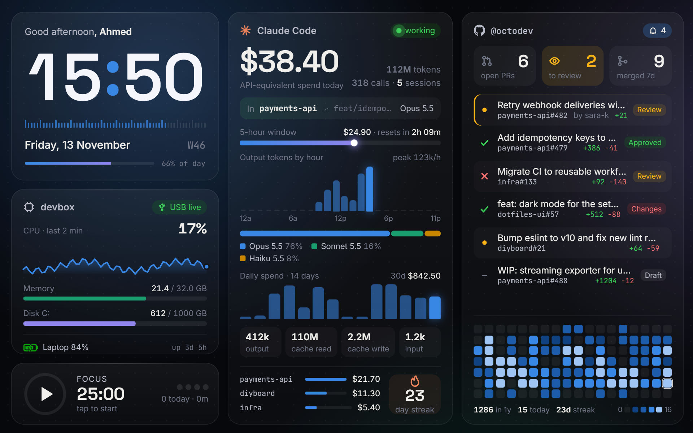
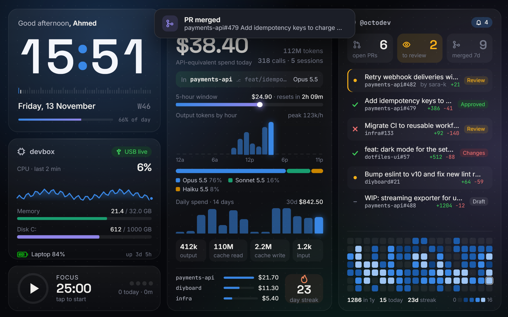
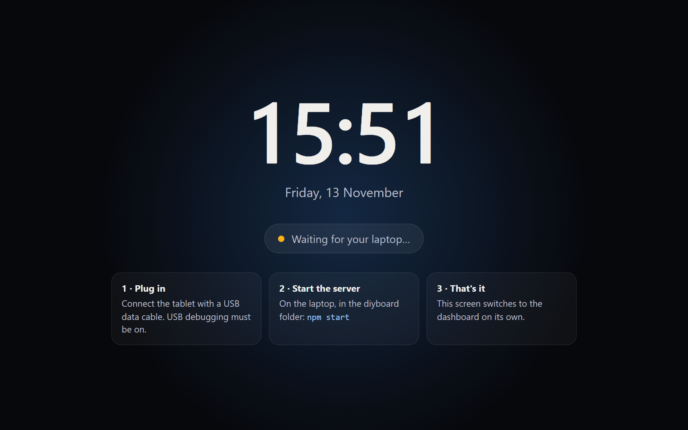
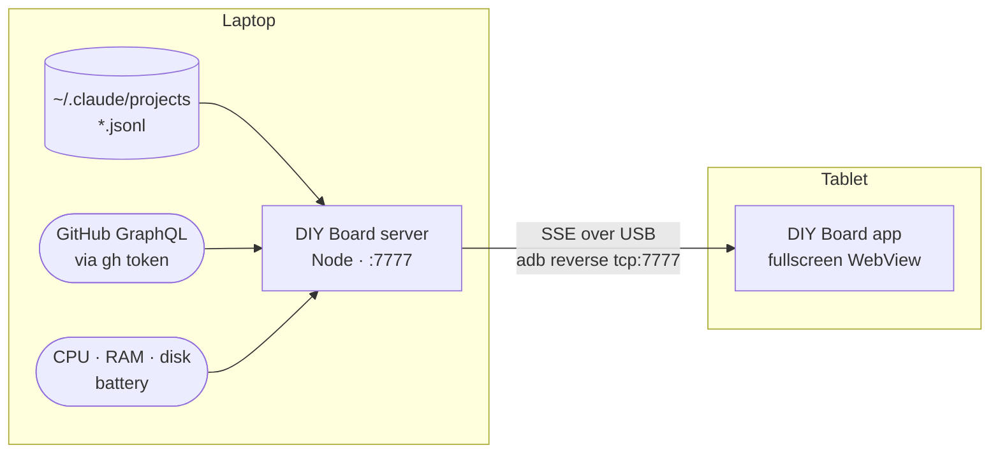

<div align="center">

# 📟 DIY Board

**Turn an old Android tablet into an animated developer dashboard, fed by your laptop over a USB cable.**

Clock · Claude Code usage · GitHub pull requests · laptop vitals · focus timer




<sub>Shown with demo data (<code>/?demo</code>). Designed for a Samsung Galaxy Tab A 8" (2017) running Android 9.</sub>

</div>

---

## ✨ What's on the board

| | Panel | What it shows |
|---|---|---|
| 🕐 | **Clock** | Rolling-digit time, a 60-tick seconds strip, date, ISO week and day progress. Tap to switch 12h/24h. |
| 💻 | **Laptop** | CPU over the last 2 minutes, memory, disk, laptop and tablet battery, uptime, USB link status. |
| 🎯 | **Focus** | Tap-to-start 25-minute deep-work timer, followed by a 5-minute break. Counts sessions per day. |
| ✳️ | **Claude Code** | API-equivalent spend today, tokens, calls, sessions, live "working" status with project and branch, the current 5-hour usage window, output tokens per hour, model mix, 14-day spend, top projects and day streak. |
| 🐙 | **GitHub** | Open PRs with CI ✓/✕/● and review state, PRs waiting for your review, PRs merged in the last 7 days, unread notifications, contribution heatmap and streak. |
| 🔔 | **Toasts** | New review request, PR merged, CI went red or green, new Claude session, tablet connected. |

Between 23:00 and 06:00 the board dims itself, and the tablet backlight too.

<table>
<tr>
<td width="50%"></td>
<td width="50%"></td>
</tr>
<tr>
<td align="center"><sub>Live notifications from GitHub and Claude Code</sub></td>
<td align="center"><sub>Built-in offline screen: reconnects by itself when the laptop is back</sub></td>
</tr>
</table>

## 🔌 How it works



- **No Wi-Fi, no pairing.** When the server sees the tablet over USB it runs `adb reverse tcp:7777 tcp:7777`,
  so the tablet's own `localhost:7777` *is* the laptop. Then it launches the app.
- **The laptop does the work.** It reads Claude Code's local transcripts incrementally (only appended bytes,
  about 120 ms per rescan over 1.3 GB of logs), polls GitHub, samples system stats, and pushes updates as Server-Sent Events.
- **The tablet just displays.** The APK is a ~16 KB Java WebView kiosk: fullscreen, keeps the screen awake, locked to landscape,
  with a native bridge for the tablet battery and backlight. The UI itself is served by the laptop, so UI changes never need a reinstall.

## 🚀 Quick start

**Laptop requirements:** Node ≥ 23.6 (it runs TypeScript directly), Android SDK platform-tools (`adb`), JDK 17
(only for building the APK), and the GitHub CLI logged in (`gh auth login`), or a `GITHUB_TOKEN` env var.

**Tablet:** turn on Developer options → USB debugging, plug it in and accept the "Allow USB debugging" prompt.

```bash
git clone https://github.com/Ahmedgito/diyboard.git
cd diyboard
npm install
npm run build     # build the dashboard UI
npm run apk       # build the Android app, install it on the tablet, launch it
npm start         # run the laptop server. Leave it running.
```

From then on, **plugging in the cable is all it takes**: the server notices the tablet, sets up the tunnel and opens the app.

> **Windows:** `npm run autostart` starts the server hidden at login (`npm run autostart -- --remove` to undo).

**Just want to look?** `npm run build && npm start`, then open <http://localhost:7777/?demo> in a browser sized 960×600.

## ⚙️ Configuration

Everything works with defaults. To change something, create `diyboard.config.json` in the project root:

```jsonc
{
  "port": 7777,              // also change SERVER in MainActivity.java, then `npm run apk`
  "autoLaunch": true,        // open the app on the tablet when it's plugged in
  "githubEnabled": true,
  "githubPollSeconds": 90,
  "claudeProjectsDir": "C:/Users/me/.claude/projects"
}
```

> 💡 The Claude cost is the **API list-price equivalent** of the tokens you used (see [`server/src/pricing.ts`](server/src/pricing.ts)).
> On a Claude subscription you aren't billed this; it's a measure of how much work went through.

## 🪫 Built for a slow tablet

The target device has a Snapdragon 425 and 2 GB of RAM. Measured on the device, **any looping CSS animation,
even a 7 px pulsing dot, keeps the GPU producing 60 frames per second.** The first version used about 235% CPU across
the WebView processes. The current version uses about 20–30% with the same look:

| Change | CPU on the tablet |
|---|---|
| First version: CSS-animated aurora, pulsing dots, 1 s transitions | ~235% |
| Ambient motion computed from time and applied on the clock's 1 Hz render | ~150% |
| Remaining loops replaced with tick-driven blinks, no transitions on live values | **~20–30%** |

Rules that came out of it:

- **Ambient motion runs at 1 fps.** The aurora drift, spinning icon and heartbeat dot are pure functions of time,
  updated on the clock's existing once-per-second render, with no CSS transitions.
  Soft shapes moving a few pixels per second still look smooth.
- **One-shot animations are fine** (entrance, count-up numbers, rolling digits, toasts) because they stop.
- **Values that update every few seconds jump** instead of tweening.

Debug switches to measure it yourself: `/?aurora=0`, `/?motion=0`, `/?tick=0`.

## 🧑‍💻 Development

```bash
npm start           # server on :7777 (serves web/dist and the SSE stream)
npm run dev         # Vite dev server on :5173 with hot reload, proxies /api to :7777
npm run typecheck
```

The UI is a fixed **960×600 stage** scaled to fit the screen. That's the Tab A's landscape size in CSS pixels.
Only changes under `android/` need `npm run apk`.

```
server/src/   index.ts  HTTP + SSE hub        claude.ts  incremental transcript reader
              github.ts GraphQL + change toasts system.ts CPU/RAM/disk/battery
              adb.ts    device watcher, reverse + launch    pricing.ts per-model prices
shared/       types shared by server and UI
web/src/      React UI: components/ per panel, demo.ts for /?demo
android/      Java WebView kiosk: offline screen, battery and brightness bridge
scripts/      apk.ts (build, install, launch) · autostart.ts (Windows login item)
```

## 📄 License

[MIT](LICENSE)
